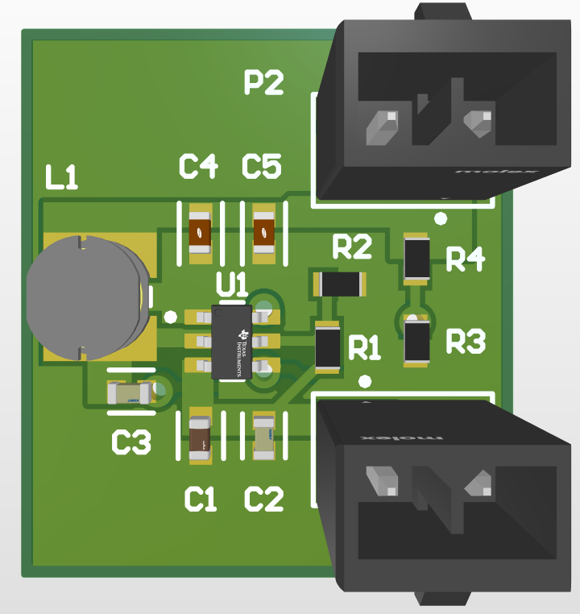

# Buck IC Converter

A compact 5 V, 3 A synchronous buck converter based on the TI TPS563208, designed in Altium Designer as my electrical onboarding project for the University of Waterloo Midnight Sun Solar Car Team.

📄 [View the schematic (PDF)](schematic.pdf)

## Specs

| | |
|---|---|
| Controller | TI TPS563208 (TSOT-23-6, synchronous buck) |
| Input | 4.5 – 17 V (IC rating) |
| Output | ~5.0 V, up to 3 A |
| Switching inductor | 3.3 µH, Bourns SDR0403-3R3ML |
| Connectors | Molex Micro-Fit+ 2-pin (input and output) |
| Board | 2-layer, ~19.5 × 21.7 mm, built to JLCPCB design rules |

## Design notes

- **Output voltage:** the feedback divider (R4 = 54.9 kΩ, R3 = 10 kΩ) sets the output: VOUT = 0.768 V × (1 + 54.9k / 10k) ≈ 4.98 V.
- **Enable:** a 47 kΩ / 10 kΩ divider from VIN to EN (R1, R2) keeps the converter off until the input voltage rises high enough.
- **Bootstrap:** a 0.1 µF capacitor (C3) between VBST and SW drives the high-side MOSFET gate.
- **Input filtering:** 10 µF bulk plus a 0.1 µF high-frequency decoupling capacitor, placed close to the VIN pin.
- **Output filtering:** 2 × 22 µF ceramic capacitors.
- **Layout:** the input capacitors, IC, inductor and output capacitors are placed tight together to keep the high-current switching loop small. The bottom layer is a ground plane.

## Bill of materials

| Designator | Part | Description |
|---|---|---|
| U1 | TPS563208DDCR | Buck regulator, 3 A, TSOT-23-6 |
| L1 | SDR0403-3R3ML | 3.3 µH power inductor |
| C1 | 10 µF | Input capacitor, 25 V X5R, 0603 |
| C2 | 0.1 µF | Input decoupling, 25 V X7R, 0603 |
| C3 | 0.1 µF | Bootstrap capacitor, 25 V X7R, 0603 |
| C4, C5 | 22 µF | Output capacitors, 16 V X5R, 0603 |
| R1 | 47 kΩ | EN divider (top) |
| R2 | 10 kΩ | EN divider (bottom) |
| R4 | 54.9 kΩ | Feedback divider (top) |
| R3 | 10 kΩ | Feedback divider (bottom) |
| P1, P2 | Molex Micro-Fit+ | 2-pin input / output connectors |

## Files

| File | Contents |
|---|---|
| `Midnight_Sun_Onboarding.PrjPcb` | Altium project file |
| `Schematic.SchDoc` | Schematic |
| `PCB1.PcbDoc` | PCB layout |
| `schematic.pdf` | Schematic export, viewable in the browser |
| `pcb-render.png` | 3D render of the board |

Open the `.PrjPcb` in Altium Designer to view the full project.
